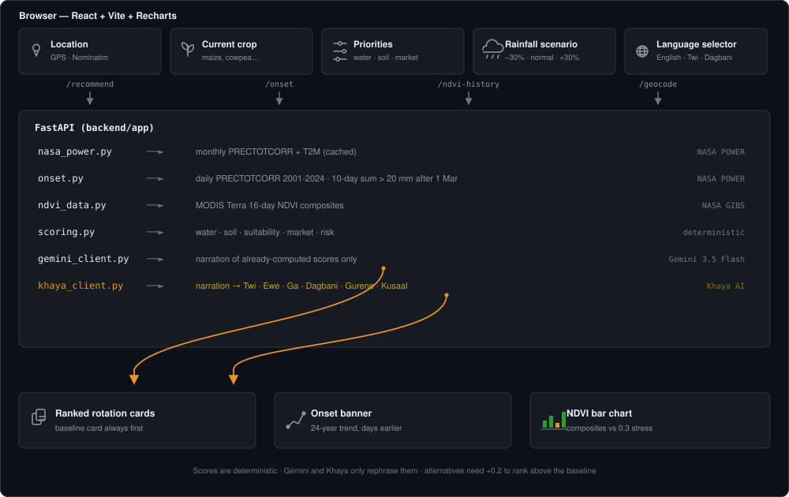

# Sankofa — Field Rotation Intelligence

NASA Space Apps Challenge 2026 | Field Shift | CypherSpace | Takoradi, Ghana

## What it does

Sankofa turns any field location in Ghana into a ranked, explainable set of crop rotations, scored on NASA rainfall and temperature, FAO crop suitability and SoilGrids soil properties. It also shows the field's 24-year seasonal onset trend from NASA POWER ("Sankofa Stat") and a MODIS NDVI vegetation timeline, so a farmer and a MoFA extension officer can see both the recommendation and the evidence behind it.

## Try it — 3 demo locations

| Location | Zone | Lat | Lon |
|---|---|---|---|
| Tamale | Guinea Savannah | 9.40 | -0.85 |
| Techiman | Transition | 7.59 | -1.93 |
| Cape Coast | Coastal Savannah | 5.11 | -1.29 |

Seven reference sites have cached onset and NDVI series, so the demo still works when the venue Wi-Fi does not: Tamale, Bolgatanga, Wa, Techiman, Kumasi, Kade, Cape Coast.

## Architecture



## NASA Data Used

| Source | What we use | Why |
|---|---|---|
| NASA POWER API | Daily + monthly rainfall (PRECTOTCORR), temperature (T2M) | Primary climate input for scoring and onset detection |
| NASA GIBS MODIS NDVI | 16-day vegetation index | Field health timeline + evidence layer |

## Other Data

| Source | What we use |
|---|---|
| ISRIC SoilGrids | Soil texture, organic carbon, pH, nitrogen |
| FAO GAEZ | Crop suitability by agro-ecological zone |
| OSM Nominatim | Place name geocoding for Ghana |

## Run in 60 seconds

```bash
# 1. Backend (Python 3.11+)
cd backend
python3 -m venv .venv && .venv/bin/pip install -r requirements.txt
.venv/bin/uvicorn app.main:app --reload --port 8000

# 2. Frontend (Node 20+), in a second terminal
cd frontend
npm install
npm run dev          # http://localhost:5173
```

The UI proxies `/api/*` to `http://127.0.0.1:8000`, so both commands are all you need.

API: `GET /recommend?lat&lon&current_crop&water_priority&soil_priority&market_priority&rainfall_factor&language`, `GET /onset?lat&lon`, `GET /ndvi-history?lat&lon`.

`language` defaults to `eng` and accepts `eng`, `twi`, `ewe`, `gaa`, `fat`, `dag`, `gur`, `kus`; the narration is translated with Khaya AI after it is generated.

Optional: copy `backend/.env.example` to `backend/.env` and add `GEMINI_API_KEY` to enable Gemini narration. Without a key, Sankofa serves a rule-based summary and labels it as such — scores never depend on the key. Add `KHAYA_API_KEY` to translate narration into Ghanaian languages; without it the text stays in English.

## AI Use

Google Gemini `gemini-3.5-flash` is used in production for plain-language narration of deterministic scores only. All AI-generated explanation text is labelled in the UI. Generative AI coding assistants were used during development to accelerate boilerplate creation and API integration.

## Notes for judges

- Scores are deterministic and reproducible; Gemini only rephrases numbers it is given, and the UI marks that text as AI generated.
- The Sankofa Stat banner and the NDVI chart load in parallel with `/recommend`, so a slow NASA response never blocks the rotation cards.
- `backend/app/data/onset_fallbacks.json` holds real NASA POWER 2001-2024 onset series captured for the seven reference sites and served when POWER is unreachable.
- `backend/app/data/ndvi_series.json` holds the bundled 16-day NDVI composites for those same sites (regenerate with `backend/scripts/gen_ndvi.py`, or swap it for an APPEEARS export); other points show the "tile overlay active" fallback.

## Scoring transparency

| Sub-score | Data source | Weight (default) |
|---|---|---|
| Rain fit | NASA POWER PRECTOTCORR vs crop water need | Farmer water priority |
| Soil fit | SoilGrids pH + SOC vs crop tolerances | Farmer soil priority |
| GAEZ suitability | FAO agro-ecological zone match | Equal weight |
| Market value | Crop library market field | Farmer market priority |

Tiebreak order: water sub-score → soil sub-score → market sub-score.
Baseline (current rotation) always appears first; alternatives must score ≥0.2 above baseline to be listed above it.
